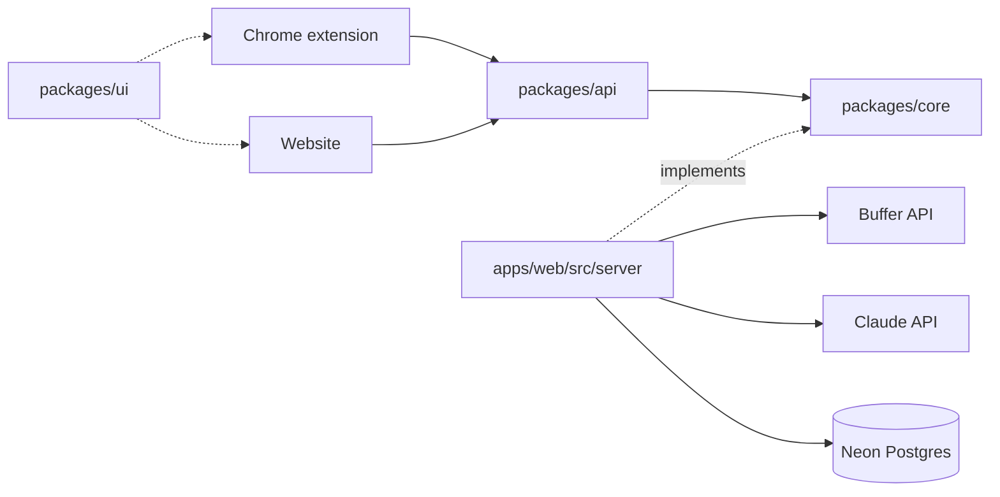

# Scroll Spark

Capture a post you like while scrolling, see how it fits each of your channels, and turn it into your next post. Built on the Buffer API for the Buffer Commit contest.

**Status:** every feature is built and tested against fakes. Nothing has run against real Buffer or Claude yet, or in real Chrome. [docs/deploy.md](docs/deploy.md) is the way to production.

## Setup

You need Node 24 or later, and pnpm through Corepack.

```bash
corepack enable
```

```bash
pnpm install
```

```bash
cp .env.example apps/web/.env.local
```

```bash
pnpm dev
```

The website runs at http://localhost:3000 and the design system at http://localhost:3000/system.

To open the extension in Chrome, go to `chrome://extensions`, turn on Developer mode, choose **Load unpacked**, and pick `apps/extension/.output/chrome-mv3-dev`. Click its toolbar icon to open the side panel. It should say "pong, side panel".

## Environment variables

| Variable                                   | Needed                             | What it does                                              |
| ------------------------------------------ | ---------------------------------- | --------------------------------------------------------- |
| `APP_URL`                                  | Production, and to sign in locally | `https://localhost:3000` in development                   |
| `BUFFER_CLIENT_ID`, `BUFFER_CLIENT_SECRET` | Production, and to sign in locally | Your Buffer app client. Use the dev client locally.       |
| `DATABASE_URL`                             | Production, and to sign in locally | Neon dev branch connection                                |
| `SECRET_KEY`                               | Production, and to sign in locally | 32 random bytes in base64, from `openssl rand -base64 32` |
| `ANTHROPIC_API_KEY`                        | Production                         | Claude, for analysis and drafts. Real calls cost money.   |
| `HEALTH_SECRET`, `HEALTH_BUFFER_USER_ID`   | After launch                       | The daily health check. See docs/deploy.md.               |
| `EXTENSION_ORIGIN`                         | Production                         | The one extension allowed to call the API                 |
| `LOG_LEVEL`                                | No                                 | `info`, `warn` or `error`                                 |

`apps/web/src/server/env.ts` validates them at startup, and production refuses to start without them.

Buffer requires HTTPS redirects, so run `pnpm dev:https` to test sign-in locally.

## Commands

| Command                                       | What it does                                                                                                           |
| --------------------------------------------- | ---------------------------------------------------------------------------------------------------------------------- |
| `pnpm dev`                                    | Runs the website and the extension build                                                                               |
| `pnpm verify`                                 | Lint, format check, types, tests, build, unused code                                                                   |
| `TEST_DATABASE_URL=… pnpm test`               | Also runs the refresh-lock test on a real Postgres, in a database whose name contains `test`. It resets that database. |
| `pnpm e2e`                                    | Browser flows. First run: `pnpm --filter @scroll-spark/web exec playwright install chromium`                           |
| `pnpm format`                                 | Formats everything                                                                                                     |
| `pnpm --filter @scroll-spark/web db:generate` | New migration from the schema                                                                                          |

## Architecture

Logic lives in `packages/core`, and the website and extension stay thin. Diagrams are in [docs/architecture.md](docs/architecture.md).



## After submitting

**Deploy freeze:** once the contest entry is sent, deploy only to fix something broken, so the app keeps matching the demo video.

## Working here

Start with [AGENTS.md](AGENTS.md). Every change begins with a failing flow test.

| Doc                                                      | Holds                                   |
| -------------------------------------------------------- | --------------------------------------- |
| [GLOSSARY.md](GLOSSARY.md)                               | Exact meanings of our words             |
| [docs/PROJECT_DEFINITION.md](docs/PROJECT_DEFINITION.md) | Product decisions and the timeline      |
| [docs/design-system.md](docs/design-system.md)           | Riso Print: colour, type, motion, voice |
| [docs/conventions.md](docs/conventions.md)               | Code patterns                           |
| [docs/testing.md](docs/testing.md)                       | Test strategy                           |
| [docs/deploy.md](docs/deploy.md)                         | Deploying and the daily health check    |
| [docs/adr/](docs/adr/)                                   | Technical decisions and why             |

## License

MIT
