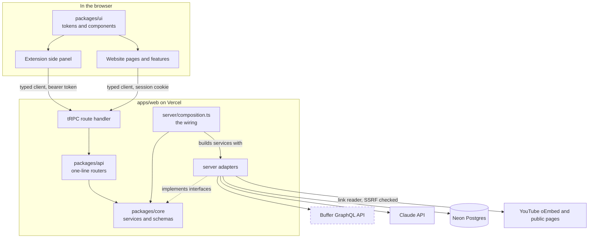
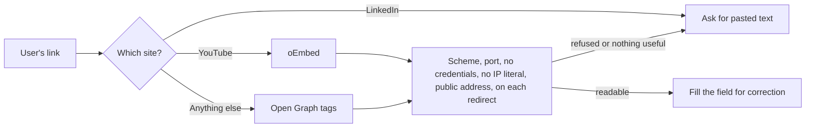
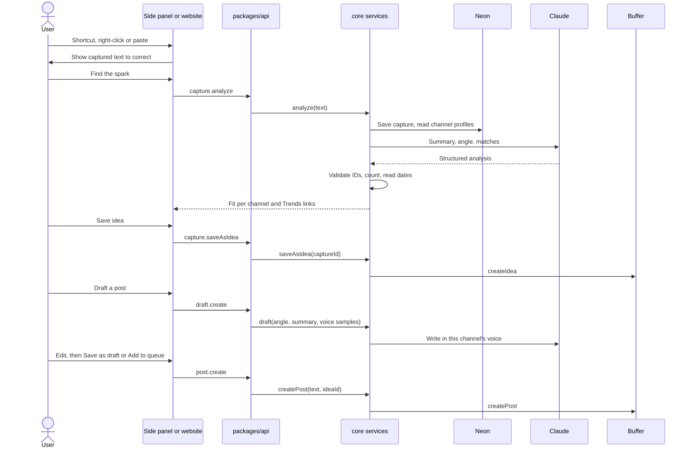
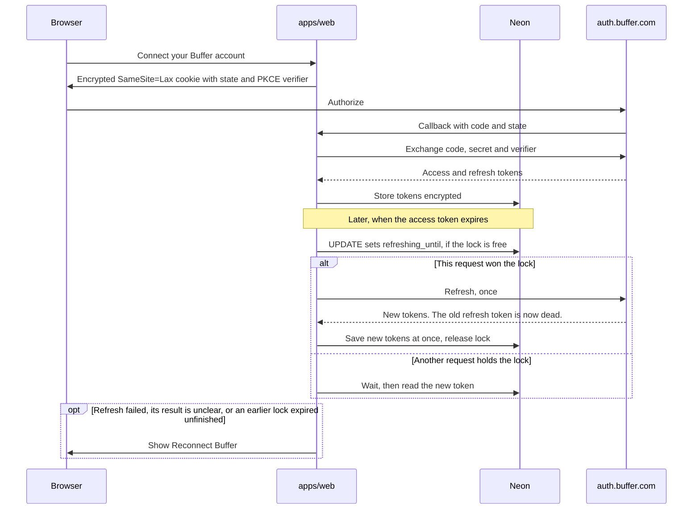

# Architecture

**Logic is portable, hosts are thin.** Business decisions live in `packages/core` and reach the outside world through interfaces. The website and extension only boot, wire and render.

Solid boxes exist today. Dashed boxes arrive with their issues. Update these diagrams in the same PR as any change to a layer, table or external service.

## System map

**Tables so far:** `users`, `buffer_grants`, `captures`, `analyses`.

## Reading a link safely

`capture.readLink` makes our server fetch a URL the user chose, so `server/capture/safe-get.ts` guards it. It uses `node:http` because a custom `lookup` checks each address at the moment of connecting, which leaves no gap for a host to pass a check and then rebind to a private address.

## From scroll to shipped post

Capturing never calls Buffer. Only an explicit save or post writes there, which protects the shared quota and keeps Ideas boards clean.

## OAuth and token refresh

## Extension sign-in

The extension opens a tab on our website, which uses the normal session and sends back a token through `externally_connectable`. The token is random, revocable, valid for 30 days, and stored only as a hash on our server. It never gives direct access to Buffer.

## Where each decision is recorded

- Product: [PROJECT_DEFINITION.md](PROJECT_DEFINITION.md)
- Technical: [adr/](adr/)
- Visual: [design-system.md](design-system.md)
