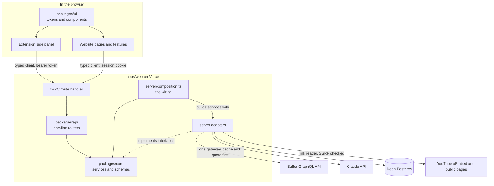
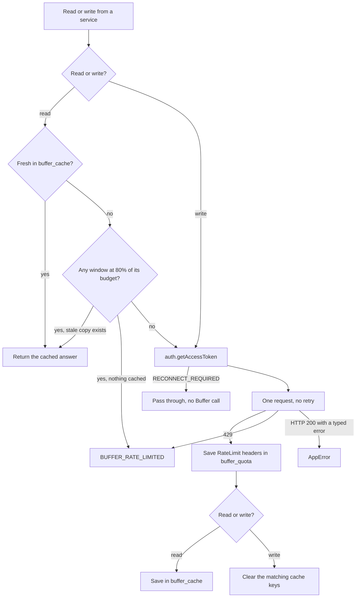
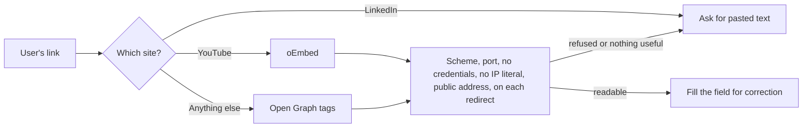
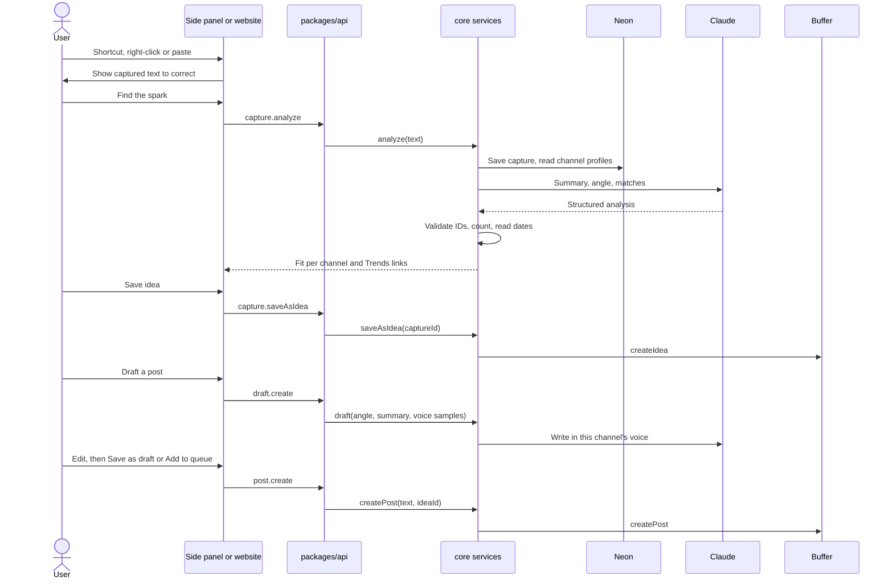
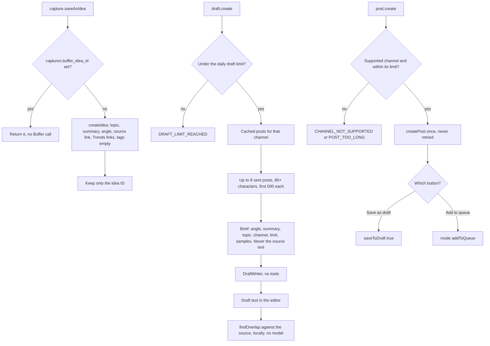
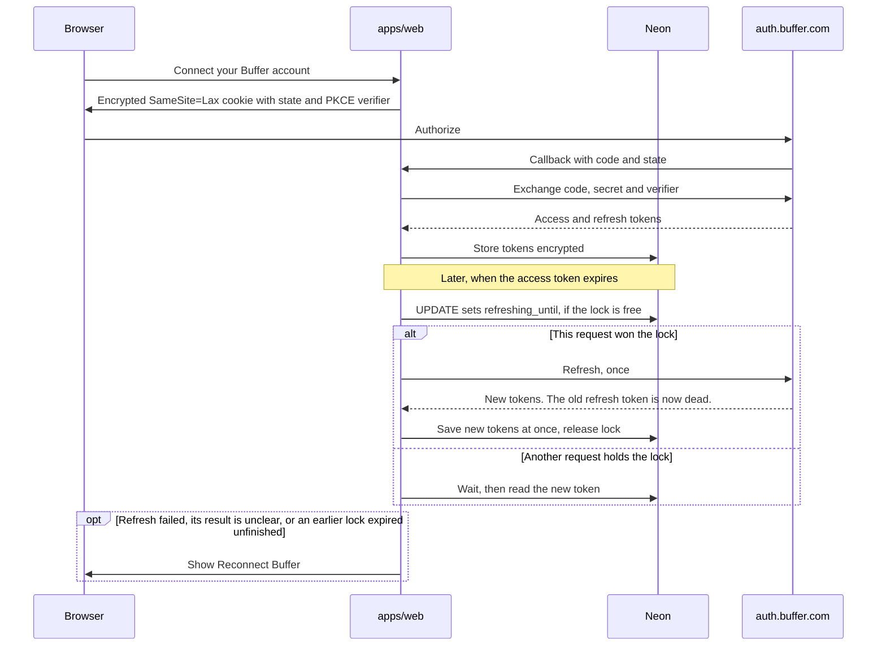

# Architecture

**Logic is portable, hosts are thin.** Business decisions live in `packages/core` and reach the outside world through interfaces. The website and extension only boot, wire and render.

Solid boxes exist today. Dashed boxes arrive with their issues. Update these diagrams in the same PR as any change to a layer, table or external service.

## System map

**Tables so far:** `users` (also holds the chosen Buffer organization and default channels), `buffer_grants`, `captures` (with `buffer_idea_id`, the only trace of a saved Idea), `analyses`, `draft_runs` (one row per draft requested, no text, for the daily limit), `buffer_cache`, `buffer_quota`.

## Every Buffer call

`api.buffer.com` is reached from one place, `server/buffer/buffer-gateway.ts`. The shared app-client quota is the thing being protected, so `core/src/buffer/buffer.service.ts` decides between cache and network before the gateway is used.

Cache lifetimes: account and channels 1 hour, ideas 15 minutes, posts 24 hours. The budget per window is the lower of the header quota and the handbook's (100 per 15 minutes, 250 per day, 3,000 per 30 days). Windows are matched by their length in seconds. Writes are never gated by the 80% rule and never retried.

## Deleting a user's data

`account.deleteMyData` calls the `account` service in `core`, which deletes the `users` row. Grants, captures and analyses cascade from it, so every new table that holds user data must reference `users` with `onDelete: "cascade"`. The page then posts to `/api/auth/disconnect?deleted=1`, which clears the session and returns to the landing page.

Buffer documents no endpoint for an app to revoke its own grant, only the user removing the app in their Buffer account settings, so Settings tells the user to do that too.

`account.status` tells the shell whether to show "Reconnect Buffer". The shell also shows it when any call fails with `RECONNECT_REQUIRED`.

## Reading a link safely

`capture.readLink` makes our server fetch a URL the user chose, so `server/capture/safe-get.ts` guards it. It uses `node:http` because a custom `lookup` checks each address at the moment of connecting, which leaves no gap for a host to pass a check and then rebind to a private address.

## From scroll to shipped post

Capturing never calls Buffer. Only an explicit save or post writes there, which protects the shared quota and keeps Ideas boards clean.

## Saving, drafting and posting

`core/src/ship/ship.service.ts` owns the last three steps. It reaches Buffer only through `BufferService`, and Claude only through the `DraftWriter` interface (the adapter is `server/llm/anthropic-drafter.ts`).

Two identical clicks that arrive while the first is still running share one call, within a server. Drafts are not stored: they live in the editor until posted, and `draft_runs` only counts requests. A draft is counted before the model is called, because a refused or failed one may still cost money.

## OAuth and token refresh

## Extension sign-in

The extension opens a tab on our website, which uses the normal session and sends back a token through `externally_connectable`. The token is random, revocable, valid for 30 days, and stored only as a hash on our server. It never gives direct access to Buffer.

## Where each decision is recorded

- Product: [PROJECT_DEFINITION.md](PROJECT_DEFINITION.md)
- Technical: [adr/](adr/)
- Visual: [design-system.md](design-system.md)
