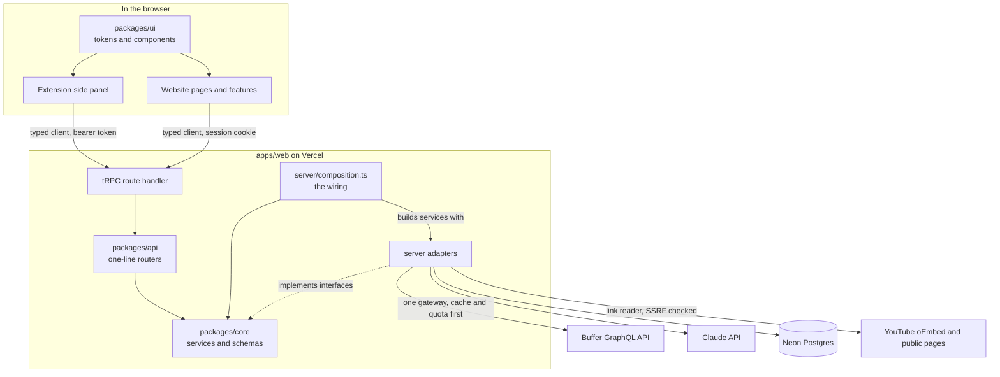
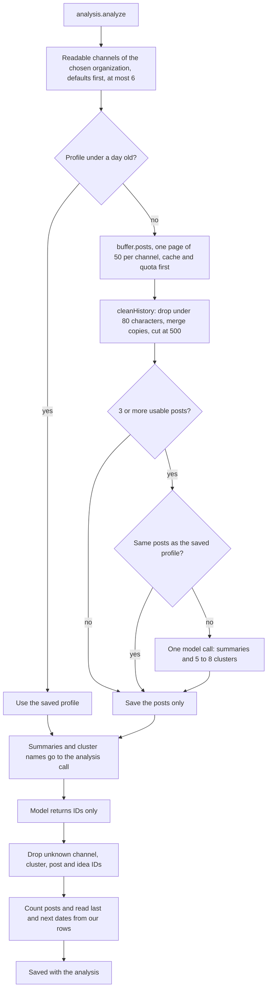
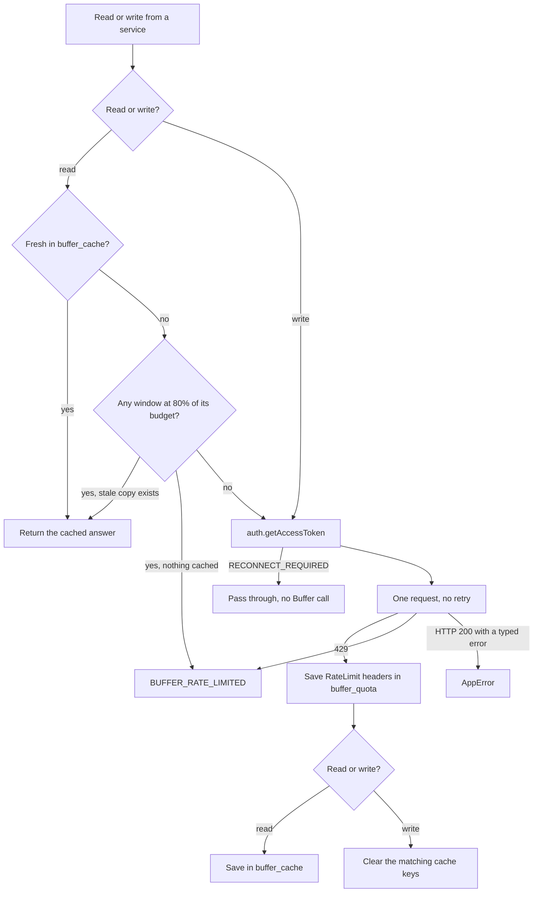
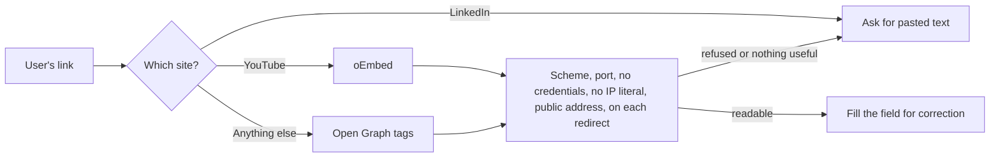
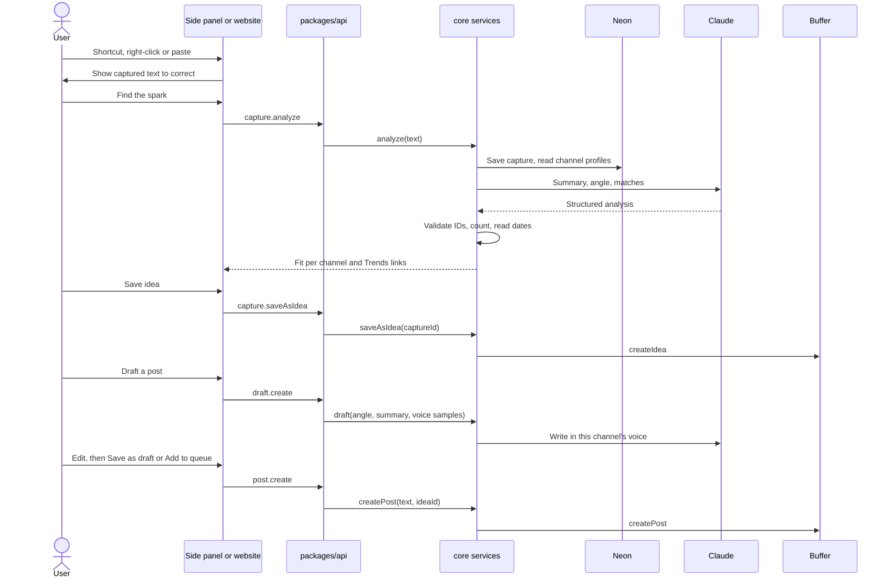
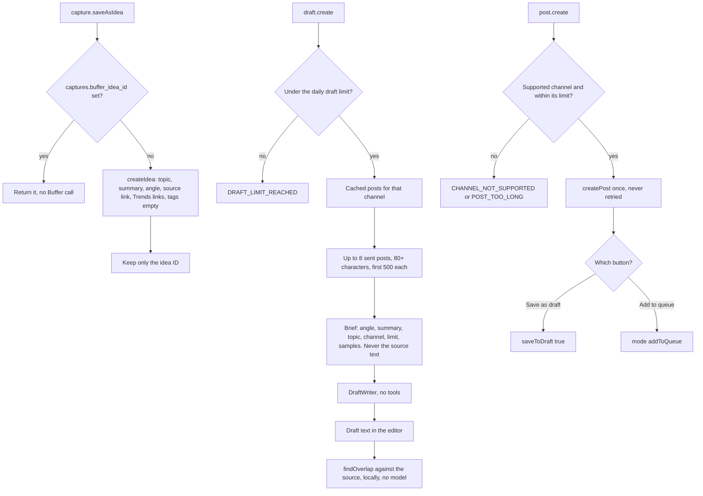
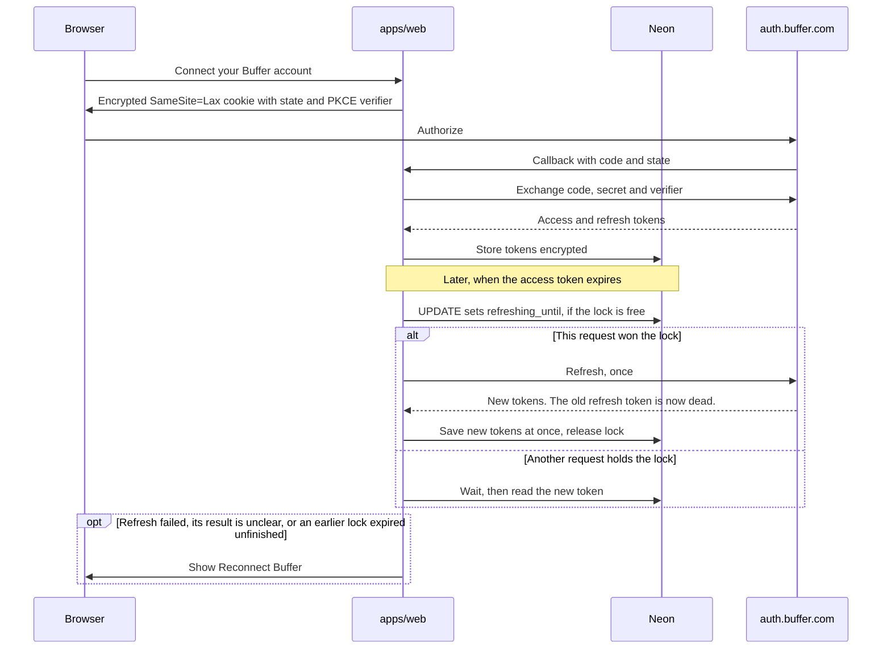
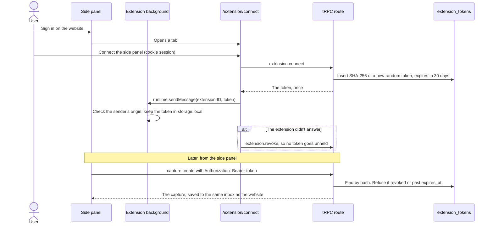
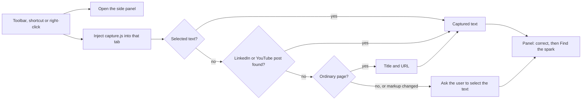
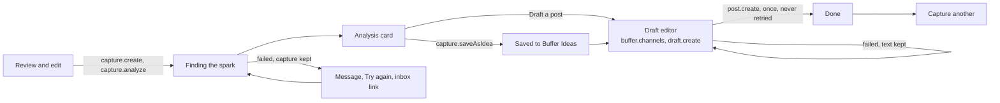

# Architecture

**Logic is portable, hosts are thin.** Business decisions live in `packages/core` and reach the outside world through interfaces. The website and extension only boot, wire and render.

Solid boxes exist today. Dashed boxes arrive with their issues. Update these diagrams in the same PR as any change to a layer, table or external service.

## System map

**Tables so far:** `users` (also holds the chosen Buffer organization and default channels), `buffer_grants`, `captures`, `analyses`, `buffer_cache`, `buffer_quota`, `extension_tokens`, and the fit check's `channel_profiles` (one row per channel, with `profile_refreshed_at`), `channel_posts` (cleaned text, one-line summary, cluster, real dates) and `channel_clusters`. `analyses` also holds `channels` and `duplicates`, the fit as it was when the analysis ran, both null for older rows, `draft_runs`.

## The fit check

`capture.analyze` runs `fit.prepare` before the model, then `fit.resolve` after it. The model only names things by ID. Every count and date comes from our own `channel_posts` rows.

A profile that can't be built leaves that channel as "unavailable" and nothing is saved, so the next analysis tries again. An expired Buffer grant stops the analysis before the model is called. The duplicate check counts matched Ideas (from the cached `buffer.ideas`) and matched scheduled posts.

## Every Buffer call

`api.buffer.com` is reached from one place, `server/buffer/buffer-gateway.ts`. The shared app-client quota is the thing being protected, so `core/src/buffer/buffer.service.ts` decides between cache and network before the gateway is used.

Cache lifetimes: account and channels 1 hour, ideas 15 minutes, posts 24 hours. The budget per window is the lower of the header quota and the handbook's (100 per 15 minutes, 250 per day, 3,000 per 30 days). Windows are matched by their length in seconds. Writes are never gated by the 80% rule and never retried.

## Deleting a user's data

`account.deleteMyData` calls the `account` service in `core`, which deletes the `users` row. Grants, captures and analyses cascade from it, so every new table that holds user data must reference `users` with `onDelete: "cascade"`. The page then posts to `/api/auth/disconnect?deleted=1`, which clears the session and returns to the landing page.

Buffer documents no endpoint for an app to revoke its own grant, only the user removing the app in their Buffer account settings, so Settings tells the user to do that too.

`account.status` tells the shell whether to show "Reconnect Buffer". The shell also shows it when any call fails with `RECONNECT_REQUIRED`.

## Reading a link safely

`capture.readLink` makes our server fetch a URL the user chose, so `server/capture/safe-get.ts` guards it. It uses `node:http` because a custom `lookup` checks each address at the moment of connecting, which leaves no gap for a host to pass a check and then rebind to a private address.

## From scroll to shipped post

Capturing never calls Buffer. Only an explicit save or post writes there, which protects the shared quota and keeps Ideas boards clean.

## Saving, drafting and posting

`core/src/ship/ship.service.ts` owns the last three steps. It reaches Buffer only through `BufferService`, and Claude only through the `DraftWriter` interface (the adapter is `server/llm/anthropic-drafter.ts`).

Two identical clicks that arrive while the first is still running share one call, within a server. Drafts are not stored: they live in the editor until posted, and `draft_runs` only counts requests. A draft is counted before the model is called, because a refused or failed one may still cost money.

## OAuth and token refresh

## Extension sign-in

The extension opens a tab on our website, which uses the normal session and sends back a token through `externally_connectable`. The token is random, revocable, valid for 30 days, and stored only as a hash on our server. It never gives direct access to Buffer.

`resolveCaller` in `packages/api/src/context.ts` picks who is calling. A bearer token wins when one is sent, and a bad one signs the request out rather than falling back to a cookie. Minting, listing and revoking tokens accept the website's cookie only, so a stolen token can't renew itself. CORS allows only `EXTENSION_ORIGIN` and never credentials. `/extension/connect` lists the active connections and revokes them.

## Capturing from a page

The background script reads a tab only after the user acts (toolbar icon, shortcut, right-click), which grants `activeTab` for that tab. It injects `capture.js`, an unlisted script that is not in the manifest, and leaves the result in `storage.session` for the panel. The panel always shows it for correction before `capture.create`.

## The side panel's flow

The panel is a thin client on the same procedures as the website. It holds no product rules: it shows what the API answers and says what failed. The analysis card, fit check, Trends links and draft editor are shared components in `packages/ui` that render props, and the website feeds them the same way. The one decision both hosts needed, which channel to write for, is `chooseChannel` in `packages/core`. The panel never chooses the Buffer organization or default channels. It links to the website's Channels page.

A queued post may publish for real, so `post.create` is sent once and never retried. Each expected failure shows its own message and leaves the user's text on screen.

## Where each decision is recorded

- Product: [PROJECT_DEFINITION.md](PROJECT_DEFINITION.md)
- Technical: [adr/](adr/)
- Visual: [design-system.md](design-system.md)
